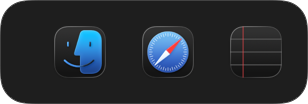
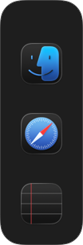
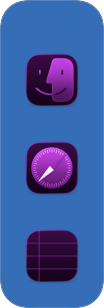

# MultiDock

Independent floating docks for macOS, built with Swift 6, AppKit, and SwiftUI. Runs locally with no accounts, telemetry, or third-party dependencies.

<p>
  
  
  
</p>

## Features

- Multiple docks with independent placement, orientation, appearance, and saved layouts.
- Drag-and-drop apps, reordering, stacks, folder shortcuts, and file opening.
- Auto-hide with reveal tabs, magnification, app-name labels, and running indicators.
- Per-dock themes, position locks, optional window previews, and advanced activation.

## Build and run

Requires an Apple Silicon Mac, macOS 14+, and a Swift 6 toolchain through Xcode or Command Line Tools.

```sh
./Scripts/build-release.sh
./Scripts/install-local.sh
```

The build produces `dist/MultiDock-arm64.zip`; the installer places the app in `~/Applications`. Open `MultiDock.xcodeproj` for Xcode development.

## Tests

```sh
./Scripts/test-core.sh --disable-sandbox
./Scripts/test-windows.sh
```

Native tests require a logged-in macOS desktop and briefly open test applications.

## Status and permissions

Version 0.10.0 is a personal-use release candidate. Local builds are ad-hoc signed, not notarized. External-display transitions and permission-granted window controls still need manual verification. Optional previews require Screen Recording; advanced window controls require Accessibility. Ordinary docks work without either permission.

Configuration stays in `~/Library/Application Support/org.multidock.MultiDock/`.
